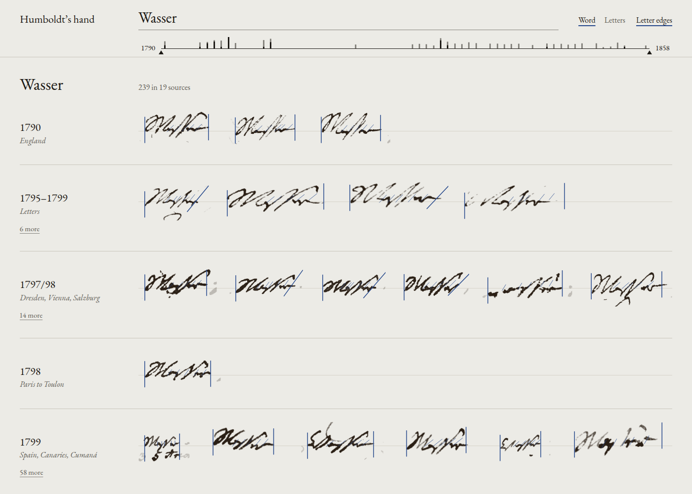

# Humboldt's Hand

How did Alexander von Humboldt write a word, or a few letters, at a given time? This page sets his own instances side
by side, cut from the manuscript scans. It is meant for the moment in a transcription when a word is unclear and you
have guesses.

**Open it:** https://maelkolb.github.io/humboldt-hand-lookup/. The crops load from BBAW digilib.

| | |
|---|---|
| sources | 12 journals and 92 letters of the *edition humboldt digital* with a scan, 957 pages, 1790–1858 |
| lines | 31,168 edition lines placed on the scans letter by letter (67.3 % of 46,313), about 206,000 words |
| placement | word ends by [littera](https://github.com/Maelkolb/littera) fine-tuned on Humboldt's hand (`littera-humboldt-ft2`), in the ink gap of the upright line; the edges between letters are the mean of littera's and those of the kraken aligner used before (aligner-k2), and stay where the two models put them when a word end moves into its gap |
| checks | on 600 held-out test lines, a small classifier trained on letter crops names 56.9 % of the letters cut at these edges, against 44.3 % with the edges of the index before and 46.7 % with the kraken aligner's index of October 2026; 42.0 % of the ink-free runs inside words have a letter edge on them, against 30.6 %. Word ends and line fit are those of the index before: 94.0 % of the word boundaries lie on an ink-free column, and the line fit tells right from wrong line texts as well as the kraken aligner's ([littera's report](https://github.com/Maelkolb/littera/blob/main/docs/HUMBOLDT.md)). No letter edges of this hand have been marked by hand yet, so these checks are indirect |

## Use
- **Word:** finds whole words and ignores spelling differences (case, long s, ß = ss, umlauts).
- **Letters:** finds a letter sequence inside words, exactly as written. `Aa` keeps the case you typed.
- **Letter edges:** a click on a crop opens the detail view, which draws the letter edges (short rules along
  the slant of the writing) and word edges (long upright rules) on the enlarged crop and on the scan, with the letters
  under their spans, in brown where littera was unsure of them. The crops in the search results stay plain. The detail view's
  "Letter edges" button switches the rules off; the browser remembers the setting.
- **Guesses:** several guesses separated by `|` give one row each. The timeline keeps a period. A click on a crop
  shows the line, the edition's text, the colour scan and the page.

## Link into it
The page reads its state from the address, so other tools can open it at a word:

| part | meaning | example |
|---|---|---|
| `q` | guesses separated by `\|`; a letter sequence in quotes | `#q=Wasser\|Waller`, `#q=%22st%22` |
| `y` | year range | `&y=1794-1805` |
| `case` | keep the case of a letter sequence | `&case=1` |
| `pin`, `box` | an image of the unclear word, shown first in every row: its URL and the box in that image's pixels | `&pin=<url>&box=x,y,w,h` |
| `d` | open the n-th crop of the first guess | `&d=3` |

## Repository

| folder | |
|---|---|
| `site/` | the page as deployed: `index.html`, `assets/` (script, styles, fonts), `data/index.json` |
| `ediarum/` | two actions for oXygen XML Author with ediarum that open the page for the selected word or letters |
| `tools/build.py` | a new index into `site/data`, the single-file page, the package to hand over |
| `docs/` | `DEPLOY.md` (servers, updates, packaging), `DATA.md` (the index format), `DESIGN.md`, screenshots |

GitHub Pages serves `site/` (`.github/workflows/pages.yml`). To run it elsewhere, copy `site/` to any web server; see
`docs/DEPLOY.md`. The index is made by the humboldt-htr pipeline: the edition's lines matched to the detected lines
of every page and placed character by character by littera (https://github.com/Maelkolb/littera) and aligner-k2
(`tools/littera_index.py` turns their placements into the index).

## Credits and licences
- **Text:** the edition humboldt digital, ed. Ottmar Ette et al., Berlin-Brandenburgische Akademie der Wissenschaften,
  https://edition-humboldt.de; TEI dataset https://github.com/telota/edition-humboldt-digital, CC BY-SA 4.0. The
  index `site/data/index.json` is derived from it and is shared under CC BY-SA 4.0 too.
- **Scans:** served by BBAW digilib; their rights stay with the holding libraries and archives.
- **Code:** MIT (`LICENSE`).
- **Font:** EB Garamond, SIL Open Font License 1.1 (`site/assets/fonts/OFL.txt`).
