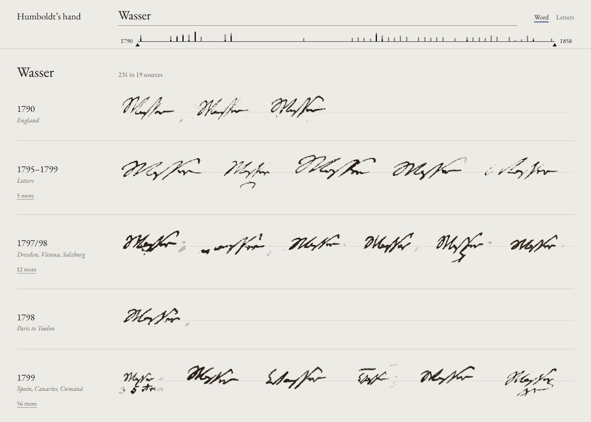

# Humboldt's Hand

How did Alexander von Humboldt write a word, or a few letters, at a given time? This page sets his own instances side
by side, cut from the manuscript scans. It is meant for the moment in a transcription when a word is unclear and you
have guesses.

**Open it:** https://maelkolb.github.io/humboldt-hand-lookup/ (one file, `index.html`; it also works when saved and
opened from disk). The crops load from BBAW digilib, so it needs the internet.

| | |
|---|---|
| sources | 12 journals and 93 letters of the *edition humboldt digital* with a scan, 956 pages, 1790–1858 |
| lines | 30,361 edition lines placed on the scans word by word (65.6 % of 46,313), about 200,000 words |
| word crops right | 91 % (blind check of 150 words) |
| letter crops right | 94 % (blind check of 132 letter sequences); inside a word a cut is right to about half a letter |

## Use
- **Word:** finds whole words and ignores spelling differences (case, long s, ß = ss, umlauts).
- **Letters:** finds a letter sequence inside words, exactly as written. `Aa` keeps the case you typed.
- **Guesses:** several guesses separated by `|` give one row each. The timeline keeps a period. A click on a crop
  shows the line, the edition's text, the colour scan and the page.

## Link into it
The page reads its state from the address, so other tools can open it at a word:

| part | meaning | example |
|---|---|---|
| `q` | guesses separated by `\|`; a letter sequence in quotes | `#q=Wasser\|Waller`, `#q=%22st%22` |
| `y` | year range | `&y=1794-1805` |
| `case` | keep the case of a letter sequence | `&case=1` |
| `pin`, `box` | an image of the unclear word, shown first in every row: its URL and the box in that image's pixels | `&pin=<url>&box=x,y,w,h` |
| `d` | open the n-th crop of the first guess | `&d=3` |

`ediarum/` holds two actions for oXygen XML Author with ediarum that open the page for the selected word or letters
(see its README).

## Rebuild
`build.py` embeds an index (schema `humboldt-hand-lookup/1`) into `ui/template.html` with the CSS, JS and fonts:
`python build.py --index <index.json> --out index.html`. The index is made by the humboldt-htr pipeline: the
edition's lines matched to the detected lines of every page and placed character by character by a CTC aligner
(kraken).

## Credits and licences
- **Text:** the edition humboldt digital, ed. Ottmar Ette et al., Berlin-Brandenburgische Akademie der Wissenschaften,
  https://edition-humboldt.de; TEI dataset https://github.com/telota/edition-humboldt-digital, CC BY-SA 4.0. The
  index inside `index.html` is derived from it and is shared under CC BY-SA 4.0 too.
- **Scans:** served by BBAW digilib; their rights stay with the holding libraries and archives.
- **Code:** MIT (`LICENSE`).
- **Font:** EB Garamond, SIL Open Font License 1.1 (`ui/fonts/OFL.txt`).
